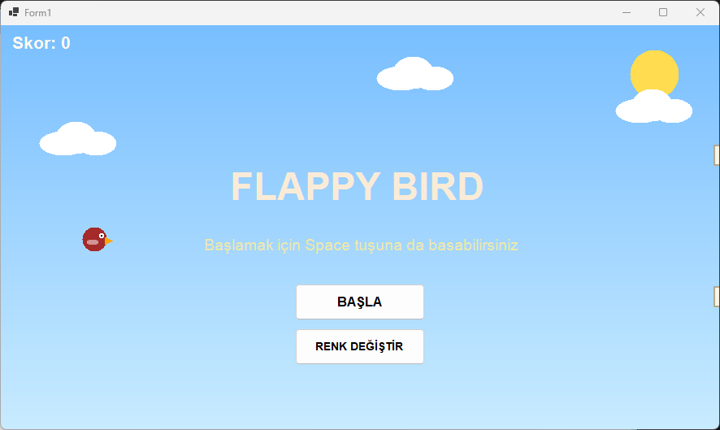
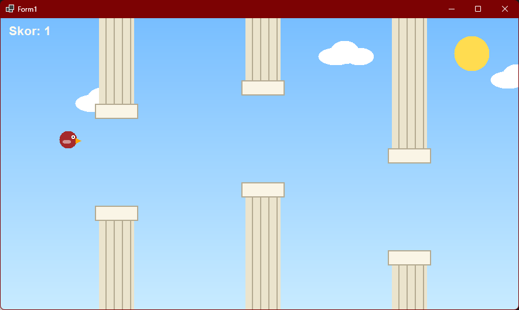
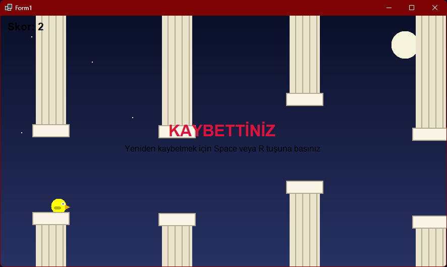

# YMH219 - Flappy Bird

Nesne Tabanlı Programlama (YMH219) dersi için geliştirilen, C# ve Windows Forms ile yapılmış bir Flappy Bird benzeri masaüstü oyunu. 

## Kullanılan Teknolojiler

- C# (.NET 10.0, `net10.0-windows`)
- Windows Forms
- Visual Studio 2026
- `System.Drawing` (`Graphics`, `LinearGradientBrush`, `FillEllipse`, `FillPolygon` vb.)
- `System.Windows.Forms.Timer` (oyun döngüsü)

## Özellikler

- Space tuşu ile zıplayan, yerçekimi etkisindeki kuş
- Sağdan sola kayan ve ekran dışına çıkınca yeniden konumlanan 4 boru
- Zemin, tavan ve boru çarpışma kontrolü
- Geçilen her boru için skor artışı
- Game Over ekranı ve Space / R ile yeniden başlatma
- Ana menü: **BAŞLA** ve **RENK DEĞİŞTİR** butonları
- Kuş rengini değiştirme (paletten 14 renk, kanat rengi parlaklığa göre otomatik ayarlanır)
- Gündüz, akşam ve gece görünümlü arka plan (saate göre değişir)
- Hareketli bulutlar, gündüz güneşi, akşam gün batımı, gece ay ve yıldızlar

## Kontroller

| TUŞ / BUTON  |         MENÜDE         |     OYUNDA    |   OYUN BİTİNCE   |
|--------------|------------------------|---------------|------------------|
| Space        |    Oyunu başlatır      | Kuşu zıplatır | Yeniden başlatır |
| R            | -                      | -             | Yeniden başlatır |
| C            | Kuş rengini değiştirir | -             | -                |
| BAŞLA        |    Oyunu başlatır      | -             | -                |
| RENK DEĞİŞTİR| Kuş rengini değiştirir | -             | -                |

## Kurulum ve Çalıştırma

### Gereksinimler

- Windows 10 veya üzeri
- Visual Studio 2022 veya üzeri, **.NET desktop development** iş yükü kurulu
- .NET 10.0 SDK

### Adımlar

1. Depoyu klonla:
   ```bash
   git clone https://github.com/[KULLANICI_ADIN]/YMH219-FlappyBird.git
   ```
2. `YMH219-FlappyBird/FlappyBird/FlappyBird.sln` dosyasını Visual Studio ile aç.
3. Üstteki yapılandırmayı **Release** seç.
4. **Ctrl+F5** ile çalıştır (hata ayıklamadan başlatır, daha akıcı çalışır).

## Ekran Görüntüleri





## Proje Yapısı

```
FlappyBird/
├── Bird.cs             # Kuşun konumu, hızı, zıplama ve renk bilgisi
├── BirdRenderer.cs     # Kuşun kod ile çizimi (gövde, kanat, göz, gaga)
├── Pipe.cs             # Boru: hareket, yeniden konumlandırma, çarpışma, çizim
├── Background.cs       # Saate göre gündüz / akşam / gece arka planı
├── Form1.cs            # Oyun döngüsü, durum yönetimi, menü ve olaylar
└── Program.cs          # Uygulamanın başlangıç noktası
```

## Bilinen Sınırlamalar ve Geliştirme Notları

- En yüksek skor kaydedilmiyor, uygulama kapanınca skor sıfırlanıyor.
- Zorluk seviyesi yok, boru hızı ve boşluk yüksekliği sabit.
- Gündüz ve gece arka planı saate göre seçiliyor, güneş ve ay sabit konumda.
- Bulutlar yalnızca gündüz görünümünde hareket ediyor.
- Kuş ve borular sabit (kodlanmış) piksel değerleriyle çiziliyor, pencere boyutu değişince orantılı ölçeklenmiyor.


Öğrencinin Adı Soyadı: Esmanur Yılmaz
Öğrenci NO: 250541033
